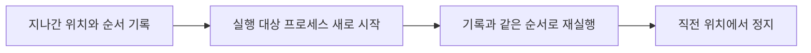

# BackDo

[디버거 프론트엔드](https://github.com/hong7ya/backdo-devtools-frontend) · [로컬 서버](https://github.com/hong7ya/backdo-server) · [랜딩 페이지](https://github.com/hong7ya/backdo-landing)

**Chrome DevTools에 거꾸로가기 버튼을 더해, 디버깅 중 지나친 실행 위치를 다시 살펴보는 프로젝트입니다.** Console에 입력한 JavaScript와 터미널에서 실행한 Node 프로그램을 지원합니다.

화면은 `backdo.site`에서 사용하고, 내 컴퓨터의 실행 대상을 관리하는 로컬 서버를 함께 실행합니다. 연결 안내와 입력 화면은 `landing.backdo.site`가 맡습니다.

## 왜 프로세스를 다시 실행하나요?

여기서 **프로세스는 사용자 코드를 실행하는 Node 프로그램 또는 Console 전용 Chrome**입니다. BackDo는 지나간 위치의 순서를 기록하고, 거꾸로가기를 누르면 실행 대상을 새로 시작해 직전 위치까지 다시 실행합니다. BackDo 웹 화면과 로컬 서버는 유지합니다.

함수 하나만 다시 실행하면 함수 밖의 변수나 이미 불러온 모듈의 상태가 남을 수 있습니다. 실행을 마친 함수는 현재 호출 목록에서도 사라집니다. **프로세스를 새로 시작하면 이런 실행 상태를 새로 만들면서, 함수와 파일의 경계를 넘어 이전 위치에 다시 도달할 수 있습니다.** Console에서는 앞서 입력한 코드를 순서대로 다시 제출하고, Node에서는 저장한 실행 조건으로 프로그램을 다시 시작합니다. Console용 Chrome은 여러 OS 프로세스로 구성될 수 있으며, 서버가 만든 브라우저 전체를 재시작합니다.



**과거 메모리를 저장했다가 복구하는 방식은 아닙니다.** 변수 값은 다시 실행하면서 계산합니다. 파일·데이터베이스·외부 서버의 상태는 프로세스 밖에 있으므로 되돌리지 못하며, 로그·요청·파일 쓰기는 다시 발생할 수 있습니다.

함수 재시작에는 async·generator 등의 제약도 있습니다. [Chrome 공식 설명](https://developer.chrome.com/docs/devtools/javascript/reference)

## 주요 기능

- **실제로 지나온 순서로 이동:** 같은 줄을 여러 번 지나도 방문 순서를 구분합니다. 기록이 유지되는 동안 실행을 마친 함수나 다른 모듈 안으로 돌아갈 수 있습니다.
- **익숙한 디버깅 조작 유지:** Console, 중단점, Step, Resume을 사용합니다. 거꾸로간 뒤에도 같은 BackDo 탭과 중단점 설정을 유지합니다.
- **진행 상태 안내:** 재실행 중에는 로딩을, 거꾸로갈 수 없을 때는 이유를 표시합니다.

예를 들어 `for`를 정상 종료한 바로 다음 문장에서 거꾸로가기를 누르면 마지막 조건식으로 돌아갑니다. `break`로 나왔다면 실제로 지나온 위치를 따릅니다.

## 사용 환경

디버거 프론트엔드는 운영자가 전용 빌드 도구로 빌드해 수동 배포합니다. 사용자는 브라우저에서 BackDo 화면에 접근하고, 자신의 컴퓨터에서 실행 대상을 관리하는 로컬 서버를 사용합니다. 서버의 Node 버전은 `.nvmrc`에 지정된 **22.11.0**을 기준으로 합니다.

## 연결하기

로컬 서버 저장소에서 목적에 맞는 명령을 실행합니다.

| 대상             | 서버 명령               | 기본 디버깅 포트 | 열리는 화면         |
| ---------------- | ----------------------- | ---------------- | ------------------- |
| Console (Chrome) | `npm run start:console` | `9222`           | `devtools_app.html` |
| Node.js          | `npm run start:node`    | `9229`           | `js_app.html`       |

Console 명령은 전용 Chrome까지 준비합니다. Node 명령은 API 서버를 준비하며, 사용자 프로젝트에서 실행할 `node --inspect-brk=127.0.0.1:9229 ./your-file.js` 명령을 안내합니다. 파일은 디버깅할 파일로 바꿉니다.

[랜딩 페이지](https://landing.backdo.site)를 열어 같은 모드를 선택하고, 서버 터미널에 안내된 디버깅 포트를 직접 입력한 뒤 **연결**을 누릅니다. 포트 입력만으로 실행 대상이 생성되지는 않습니다. 열린 Console 화면에는 JavaScript를 입력하고, Node 화면에서는 준비한 프로그램을 디버깅합니다.

다른 포트는 서버 명령 뒤에 `-- --port 9333`처럼 지정합니다. Node 실행 명령과 랜딩 입력에도 서버가 안내한 같은 포트를 사용합니다. 프론트는 기존 로컬 API 주소 `http://127.0.0.1:3000`으로 대상 등록을 요청합니다. WebSocket 주소를 직접 전달하는 기존 연결도 유지합니다.

## 거꾸로가기와 종료

중단점에서 멈춘 뒤 Step 또는 Resume으로 진행하고 거꾸로가기 버튼을 누릅니다. 첫 정지에는 이전 기록이 없거나 준비 중이어서 버튼이 비활성일 수 있습니다.

로컬 서버 터미널에서 `Ctrl+C`를 누르면 서버가 만든 Chrome과 재시작한 Node를 함께 정리합니다. 재시작한 Node의 출력은 서버 터미널로 전달됩니다. 사용자가 직접 실행했고 BackDo가 아직 재시작하지 않은 Node는 자동으로 종료하지 않습니다.

## 사용 범위와 한계

| 구분                  | 범위                                                                                                                     |
| --------------------- | ------------------------------------------------------------------------------------------------------------------------ |
| 검증 예제가 있는 동작 | 반복문, `break`, 간단한 `async/await`, 실행을 마친 함수·Console 코드, Node의 `import`·`import()`로 불러온 모듈 사이 이동 |
| 추가 검증 대상        | 여러 비동기 작업의 순서가 달라지는 경우, 비동기 경계에서의 Step 동작, 다양한 실행 옵션 조합                              |
| 지원하지 않는 동작    | Worker·여러 프로세스를 함께 되돌리기, 터미널 입력을 기다리는 프로그램, 로컬 서버를 종료한 뒤 이전 기록으로 거꾸로가기    |

- **같은 위치가 같은 값을 보장하지는 않습니다.** 시간·난수·외부 응답이 달라지면 값도 달라질 수 있습니다. 재실행 중 코드 내용이나 실행 순서가 기록과 달라지면 중단합니다.
- **기록은 현재 BackDo 탭의 메모리에 있습니다.** 탭을 닫거나 새로고침한 뒤 이전 기록을 불러오지 못합니다. 오래 멈춰 있다는 이유만으로 기록이 만료되지는 않습니다.
- **실행 대상이 살아 있고 기록이 유지되면, 함수 실행이 끝난 뒤에도 돌아갈 수 있습니다.** 로컬 서버를 종료한 뒤 과거 기록을 다시 사용하는 것과는 다릅니다.
- **수동 변경과 외부 자원은 이어받지 않습니다.** 멈춘 상태에서 Console로 바꾼 값, 기존 터미널 입력, 열린 파일·소켓은 재실행 때 복구하지 않습니다.
- **기록과 재실행에는 비용이 듭니다.** 실행 위치를 기록할 때 내부적으로 잠깐 멈춘 뒤 계속 실행하므로, 일반 실행보다 느릴 수 있습니다.

## 기술 구성

이 저장소는 TypeScript 기반 Chrome DevTools 프론트엔드입니다. 로컬 서버는 별도 저장소에서 Node.js·Express·Puppeteer로 실행 대상을 관리합니다. 디버깅 명령과 응답에는 CDP(Chrome DevTools Protocol)를 사용합니다.

## 기록 한도

**기록량은 다시 실행할 때 필요한 CDP 통신의 예상 시간이 3초 미만인 범위로 제한합니다.** CDP는 BackDo와 실행 대상이 디버깅 명령·응답을 주고받는 규약입니다. 같은 수의 기록도 환경에 따라 처리 시간이 달라지므로, 고정된 기록 개수나 메모리 용량 대신 현재 환경의 응답 속도를 기준으로 삼습니다.

첫 정지 후 사용자 코드와 분리된 작은 프로그램을 잠시 실행합니다. 이 프로그램에 멈출 수 있는 위치를 조회하는 CDP 요청을 보내고, 응답이 돌아오기까지 걸린 시간을 구합니다. 사용자 코드를 추가로 실행하지 않으며, 확인이 끝나면 이 프로그램을 종료합니다.

```text
T = CDP 요청 한 번을 보내고 응답을 받는 데 걸린 시간(ms)
N = 기록된 실행 위치의 방문 횟수

예상 CDP 처리 시간 = T × N
기록 유지 조건 = T × N < 3,000ms
사용률(%) = (T × N) ÷ 3,000ms × 100
```

응답이 빠른 환경에서는 더 많은 기록을 유지하고, 느린 환경에서는 더 적게 유지합니다. 같은 줄을 반복 방문해도 방문할 때마다 N이 증가합니다. 거꾸로간 뒤 미래 기록을 버리면 N과 예상 비용도 함께 줄어듭니다.

예상 비용이 3초에 도달하면 기록 전체를 해제하고 거꾸로가기를 비활성화합니다. 앞부분만 지우면 처음부터 실행 순서를 대조할 수 없기 때문입니다. 일반 디버깅은 계속 사용할 수 있습니다.

이 방식은 **메모리에 보관할 실행 기록량을 예상 처리 시간으로 제한하는 정책**입니다. 메모리 바이트를 직접 측정하거나 환산하지 않으며, 별도의 고정 개수·용량 상한은 두지 않습니다. 사용자 코드의 계산·비동기 대기·프로세스 시작·화면 표시 시간은 위 식에 포함하지 않으므로, 실제 거꾸로가기 완료 시간을 보장하는 수치는 아닙니다.

## 아이디어 선정 배경

### 디버거에서 앞으로 가기가 있는 데, 왜 거꾸로 가기는 없는 지에 대한 의문

기존 디버거는 여러 가지 버전으로 앞으로 가는 기능을 제공하고 있습니다. step, step into, step out, step over… 그런데 왜 거꾸로 가는 기능은 없는지 이따금 의문이 생깁니다. 바쁘게 코드를 디버깅하다가 순간 들러야 하는 줄을 지나치게 될 때는 아쉽기도 합니다. 이러한 순간들을 모아 BackDo 프로젝트로 승화했습니다. 디버거의 도구모음 중 하나로 이질감 없는 위치에 BackDo 버튼이 있습니다. 직관적으로 버튼 한 번만 누르면 작동합니다.

### 자유롭게 거꾸로 가고, 이후에는 새로운 경로로 탐색 희망

비디오 녹화처럼 단순히 기억을 되짚고 정해진 시나리오만 보는 것이 아니라, 실제로 소스 코드와 상호작용하고 싶었습니다. 이전에는 들어가지 않았던 함수 내부로 들어가 보거나 건너뛰는 등, 돌아온 위치에서 새로운 경로를 탐색하는 것이 목표였습니다.

## 회고

개발자 도구를 처음 써보게 되었을 때 왜 거꾸로 가기 기능이 없을까 라고 생각했던 때가 선명합니다. 이때는 몰랐습니다. 3달 뒤 제가 프로젝트 주제로 삼을 지 말입니다.

주제의 특성상 기존에 존재하는 코드를 해석해서 원하는 기능을 삽입하는 첫 경험을 하게 되었습니다. 기술 스택도 생소하고 적응하는 데 쉽지 않았으나 실마리를 하나하나 찾아 적용해 나가는 과정은 매우 흥미진진했습니다.

언젠가 오픈 소스에 기여하고 싶다는 소망을 갖게 되기도 했습니다. 개발자 도구 관련해서도 많이 배웠고 도전해서 얻는 기쁨을 만끽할 수 있는 프로젝트였습니다.
